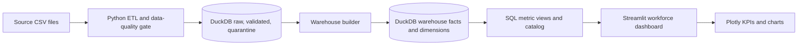

# PulseIQ

PulseIQ is a workforce analytics project for **Zenith Nova Technologies, part of Aura Workforce**. It turns HR and operational CSV data into a validated DuckDB warehouse, governed workforce metrics, and an interactive headcount dashboard for leaders who need a clear view of workforce size, movement, and composition.

## Live demo

The app is not publicly deployed. Run it locally with the steps below. Dashboard evidence is available in [the summary screenshot](task5-workforce-dashboard.png) and [the department breakdown screenshot](task5-workforce-breakdowns.png).

## Features

- Data contracts, validation, quarantine, reconciliation, and a 14-check data-quality gate.
- Dimensional warehouse with employee history and star-schema facts and dimensions.
- 29 governed metric views with catalog definitions, minimum-group suppression, and hand-check evidence.
- Streamlit workforce dashboard with department/date filters, five KPIs, headcount trend, department mix, location-tier mix, and work-mode mix.
- M29 Net hires: hires minus exits at department/month grain, displayed for the selected dashboard period.
- Insight-led chart headlines and compact, three-color visual semantics.

## Tech stack

- Python 3.11+
- DuckDB
- Streamlit
- Plotly
- pandas
- CSV source data and SQL metric views

## Run it locally

1. Install Python 3.11 or newer and clone the repository:

   ```powershell
   git clone https://github.com/Anusraj/Pulseiq.git
   cd Pulseiq
   ```

2. Create and activate a virtual environment:

   ```powershell
   py -3.11 -m venv .venv
   .\.venv\Scripts\Activate.ps1
   ```

3. Install dependencies:

   ```powershell
   python -m pip install -r starter\requirements.txt
   ```

4. Build the raw/validated ETL outputs, warehouse, and governed metric views:

   ```powershell
   python etl.py
   python warehouse.py
   python metrics.py
   ```

5. Start the app and open the local URL printed by Streamlit, usually `http://localhost:8501`:

   ```powershell
   streamlit run app.py
   ```

The ETL gate exits nonzero when a critical data-quality check fails. See [the DQ guide](docs/dq-gate.md), [the warehouse guide](docs/warehouse.md), and [the metric-layer guide](docs/task4-metric-layer.md) for pipeline details.

## Architecture



The dashboard queries metric views only. M01-M03 provide headcount, hires, and exits; M29 provides net hiring; supporting metric views provide department labels and effective-dated location/work-mode breakdowns. Raw and warehouse tables are not queried by the app.

## How I verified it works

- `python metrics.py` builds and validates all 29 official views; the latest run passed the view and small-group checks.
- Six independently calculated examples pass in `metric_hand_checks.csv`, including M29: D01 / January 2020 has 1 hire and 2 exits, so net hires is `-1`.
- `metric_view_validation.csv` records 0 below-threshold groups for every official view, including M29.
- The dashboard data loader and Python compilation were checked; the live page rendered all five KPIs and four charts.
- The DQ gate's isolated tests can be run with `python dq_gate.py --self-test`; see `dq_self_test_results.csv` for existing evidence.

## Limitations and what I would do next

- The app uses the supplied CSV dataset and local DuckDB file; it is not deployed with authentication, role-based access, or scheduled refresh.
- Groups below five are suppressed. Totals from category breakdowns may be lower than department-level headcount because suppression is applied at each view's grain.
- M29 excludes transfers and sums reportable department/month values, so suppressed groups are not represented in its dashboard total.
- Next: connect a scheduled refresh, add deployment and access controls, and automate browser-level tests across desktop and mobile layouts.

Further evidence and definitions: [Task 2 warehouse](docs/task2-evidence.md), [Task 4 metric layer](docs/task4-metric-layer.md), and [Task 5 dashboard](docs/task5-evidence.md).