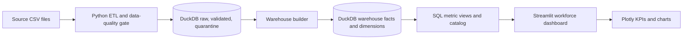

# PulseIQ

PulseIQ is a workforce analytics project for **Zenith Nova Technologies, part of Aura Workforce**. It turns HR and operational CSV data into a validated DuckDB warehouse, governed workforce metrics, and an interactive headcount dashboard for leaders who need a clear view of workforce size, movement, and composition.

## Live demo

Deploy `app.py` from this repository with Streamlit Community Cloud. The
release snapshot is `data/pulseiq_public.duckdb`; it contains governed
aggregates only and is refreshed by `.github/workflows/monthly-report.yml`.
See [Task 17 release evidence](phase4/task-17/README.md) for the hosting
decision, 200 MB budget, refresh schedule, and stranger-test checklist.
Dashboard evidence is available in [the summary screenshot](task5-workforce-dashboard.png)
and [the department breakdown screenshot](task5-workforce-breakdowns.png).

## Features

- Data contracts, validation, quarantine, reconciliation, and a 14-check data-quality gate.
- Dimensional warehouse with employee history and star-schema facts and dimensions.
- 29 governed metric views with catalog definitions, minimum-group suppression, and hand-check evidence.
- Streamlit workforce dashboard with department/date filters, five KPIs, headcount trend, department mix, location-tier mix, and work-mode mix.
- M29 Net hires: hires minus exits at department/month grain, displayed for the selected dashboard period.
- Profit and loss page with monthly ledger margin, expense categories, top vendors, and README headline tie-out.
- Receivables and cash page with ageing buckets, client payment behaviour, overdue clients, and cash flow.
- Cross-department impact page joining headcount, payroll, attendance, leave and attrition at department-month grain.
- AI signals page ranking anomaly money at risk, showing forecast confidence bands and known-month error.
- Executive company-health scorecard with eight governed KPIs, target status, month selector, and print styling.
- Insight-led chart headlines and compact, three-color visual semantics.

## Tech stack

- Python 3.11+
- DuckDB
- Streamlit
- Plotly
- pandas
- CSV source data and SQL metric views
- ReportLab PDF report builder with pinned dependencies

## Run it locally

1. Install Python 3.11 or newer and clone the repository:

   ```powershell
   git clone https://github.com/Anusraj/Pulseiq.git
   cd Pulseiq
   ```

2. Create and activate a virtual environment:

   ```powershell
   py -3.11 -m venv .venv
   .\.venv\Scripts\Activate.ps1
   ```

3. Install pinned dependencies:

   ```powershell
   python -m pip install -r phase4\task-16\requirements.txt
   ```

4. Build the raw/validated ETL outputs, warehouse, and governed metric views:
   ```powershell
   python etl.py
   python warehouse.py
   python metrics.py
   ```

5. Build the monthly report pack. The command works for any closed month and
   writes a stamped PDF containing five governed tables/charts:

   ```powershell
   python phase4\task-16\build_report.py --month 2026-09
   ```

   The output is `phase4\task-16\reports\pulseiq-2026-09.pdf`. Every pack shows its reporting
   date range, data cut-off, and generation timestamp. Use `--output` to choose
   another path or `--database` for another DuckDB file.

6. Run the release checks:

   ```powershell
   python -m unittest discover -s phase4\task-16\tests -p "test_*.py" -v
   ```

   The report test creates a clean temporary DuckDB with a previously unseen
   department and verifies that the department appears without code changes.

7. Start the app and open the local URL printed by Streamlit, usually `http://localhost:8501`:

   ```powershell
   streamlit run app.py
   ```

   If Windows Application Control blocks `streamlit.exe`, invoke Streamlit
   through the virtual-environment Python interpreter instead:

   ```powershell
   python -m streamlit run app.py
   ```

   If Windows Application Control reports that `pyarrow.lib` is blocked,
   reinstall the pinned native wheel in the project environment:

   ```powershell
   .\.venv\Scripts\python.exe -m pip install --force-reinstall --no-cache-dir pyarrow==17.0.0
   .\.venv\Scripts\python.exe -c "import pyarrow; print(pyarrow.__version__)"
   ```

The ETL gate exits nonzero when a critical data-quality check fails. See [the DQ guide](docs/dq-gate.md), [the warehouse guide](docs/warehouse.md), and [the metric-layer guide](docs/task4-metric-layer.md) for pipeline details.

## Architecture



The dashboard queries metric views only. M01-M03 provide headcount, hires, and exits; M29 provides net hiring; supporting metric views provide department labels and effective-dated location/work-mode breakdowns. Raw and warehouse tables are not queried by the app.

## How I verified it works

- `python metrics.py` builds and validates all 29 official views; the latest run passed the view and small-group checks.
- Six independently calculated examples pass in `metric_hand_checks.csv`, including M29: D01 / January 2020 has 1 hire and 2 exits, so net hires is `-1`.
- `metric_view_validation.csv` records 0 below-threshold groups for every official view, including M29.
- The dashboard data loader and Python compilation were checked; the live page rendered all five KPIs and four charts.
- `python phase4\task-16\build_report.py --month 2026-09` creates the sample
  management pack at `phase4\task-16\reports\pulseiq-2026-09.pdf`; it includes
  the date range and data cut-off.
- The standard-library test suite passes, including the new-department fixture.
- `.github\workflows\monthly-report.yml` runs on the first day of each month
  for the previous month and also supports manual `workflow_dispatch`.
- The DQ gate's isolated tests can be run with `python dq_gate.py --self-test`; see `dq_self_test_results.csv` for existing evidence.

## Limitations and what I would do next

- The public release publishes governed aggregate metrics without
  authentication or role-based access. Streamlit Community Cloud may sleep
  between visits; a paid always-on plan would be appropriate if a cold start
  hurt real users.
- Groups below five are suppressed. Totals from category breakdowns may be lower than department-level headcount because suppression is applied at each view's grain.
- M29 excludes transfers and sums reportable department/month values, so suppressed groups are not represented in its dashboard total.
- Next: add access controls and automate browser-level tests across desktop and
  mobile layouts.

Further evidence and definitions: [Task 2 warehouse](docs/task2-evidence.md), [Task 4 metric layer](docs/task4-metric-layer.md), [Task 5 dashboard](docs/task5-evidence.md), [Task 11 P&L](docs/task11-evidence.md), [Task 12 receivables and cash](docs/task12-evidence.md), [Task 13 department impact](docs/task13-evidence.md), [Task 14 AI signals](docs/task14-evidence.md), and [Task 16 release evidence](phase4/task-16/task16-evidence.md).

## What I learned and problems solved (Tasks 1–5)

### Task 1: ETL and data validation

**What I learned**

- Keeping the original source values makes it possible to audit what arrived, even when a value cannot be loaded as valid data.
- Data contracts and the data dictionary make validation explicit instead of relying on assumptions about each CSV.
- Separating validated rows from quarantined rows helps downstream steps use trusted data without losing evidence of rejected input.

**Problems I hit and how I solved them**

Source rows can have invalid values or widths, and feeds can include extra columns. I routed invalid rows to quarantine with a reason, accepted formatted numeric text such as values with thousands separators, and retained unexpected columns with a warning. Missing contracted columns remain a visible ETL error rather than being silently ignored.

### Task 2: dimensional warehouse

**What I learned**

- Fact tables need a clear grain, while dimensions provide the descriptive context for interpreting their measurements.
- Employee history requires a different surrogate key for each effective-dated version; historical facts must join to the version valid at the time.
- Reconciliation and relationship checks help prove that warehouse modeling has not silently lost or misattributed source rows.

**Problems I hit and how I solved them**

Some passed rows had employee IDs that could not resolve to an effective employee version, while some other relationships were intentionally optional. I retained those fact rows, mapped unresolved employees to an explicit unknown member, and kept optional null keys distinct from actual orphan keys. Row-count, orphan, and SCD identity checks provide evidence for those decisions.

### Task 3: data-quality gatekeeper

**What I learned**

- Schema and type validation alone cannot catch business problems such as unbalanced ledger entries or payroll duplicates.
- Severity matters: critical findings should stop publication, while warnings should remain visible for an owner to investigate.
- A check is more trustworthy when its detection logic is tested against deliberately injected bad data.

**Problems I hit and how I solved them**

The supplied feeds contain planted issues across payroll, accounting, dates, and employee history. I added 14 checks against the raw feeds, recorded findings without rewriting source rows, and verified the known seeded issues were detected. Isolated self-tests exercise the same SQL checks without changing the live tables.

### Task 4: governed metric layer

**What I learned**

- A metric needs a documented formula, grain, period, unit, owner, caveat, and privacy rule—not just a SQL expression.
- Consistent views give dashboard consumers a stable interface and reduce the chance that each consumer calculates a metric differently.
- Hand calculations and minimum-group checks help verify both metric correctness and privacy behavior.

**Problems I hit and how I solved them**

The dictionary and worked example specified different M04 attrition denominators, so I used the average of starting and ending headcount and retained the original dictionary formula for traceability. Duplicate payroll rows and unknown employee keys could inflate cost metrics, so the payroll eligibility helper excludes unknown-key rows and collapses exact duplicate employee/run records without modifying source facts.

### Task 5: workforce dashboard

**What I learned**

- A dashboard is easier to trust when it queries governed metric views instead of rebuilding business logic from raw or warehouse tables.
- Filters, KPI cards, and charts need to use the same selected period and department context to tell a consistent story.
- Privacy suppression at different breakdown grains can make category totals lower than department-level headcount.

**Problems I hit and how I solved them**

The department, location-tier, and work-mode breakdowns can omit groups below the reporting threshold, so their totals do not always equal the headline headcount; the dashboard evidence explains that behavior. Net hires also needed an explicit definition, so I exposed M29 as hires minus exits at department/month grain and checked the displayed result against a hand calculation.