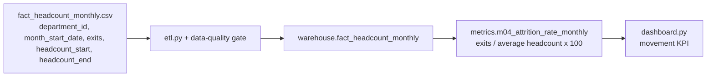
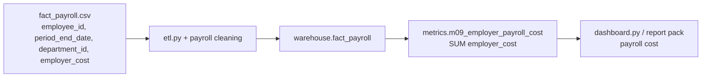
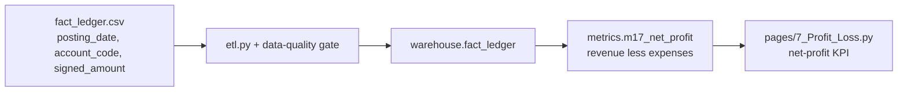
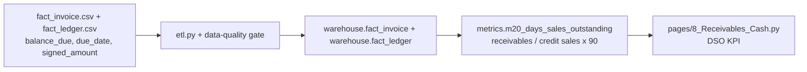

# Task 19 metric lineage

Each diagram traces the value returned by the API from the raw feed through
ETL, the warehouse, the governed metric view, and the consuming dashboard.
The API response repeats the same source fields so a caller does not need to
open this document to understand a number.

## M01 Headcount

## M04 Monthly attrition

## M09 Employer payroll cost

## M17 Net profit

## M20 Days sales outstanding

## Raw-column rename impact

The following exposed metrics would break or change if the named raw columns
were renamed without updating the ETL contracts and downstream SQL:

| Raw column change | Metrics affected |
| --- | --- |
| `employee_id`, `hire_date`, `exit_date`, or `department_id` in headcount feed | M01, M04 |
| `month_start_date`, `exits`, `headcount_start`, or `headcount_end` | M04 |
| `employee_id`, `period_end_date`, `department_id`, or `employer_cost` in payroll feed | M09 |
| `posting_date`, `account_code`, or `signed_amount` in ledger feed | M17 and M20 |
| `balance_due` or `due_date` in invoice feed | M20 |

These are schema dependencies, not guesses: they are the columns declared in
the API's `source.raw_columns` field and in each diagram.
